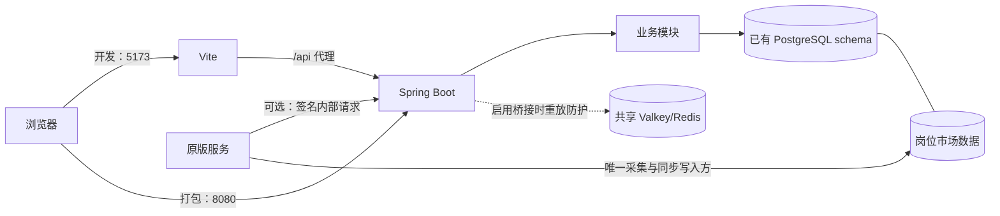

# 架构与边界

JobTrace Java 是一个 Spring Boot 模块化单体。React 前端位于 `frontend/`，只通过 `/api` 与服务端交互。开发时 Vite（默认 5173）代理 API 到 Spring Boot（默认 8080）；Maven 打包时编译前端并嵌入 JAR，因此 8080 也能提供静态页面。两个端口可同时访问页面，并不代表存在两套后端。

## 模块与依赖方向

`src/main/java/com/jobtrace/` 包含 `applications`、`interviews`、`analytics`、`reminders`、`datatransfer`、`jobmarket`、`identityaccess` 与 `shared`。每个业务模块保持 `web → application → domain` 的调用方向；`infrastructure` 实现应用层的数据库与外部服务端口。跨模块调用应通过明确的应用契约，不通过控制器相互调用。

- `web`：HTTP 路由、认证入口、输入与错误映射。
- `application`：用例、事务边界、查询和命令端口。
- `domain`：业务术语、约束与不变量。
- `infrastructure`：Spring JDBC/jOOQ、外部邮件、对象存储和可选重放存储。

## 账号与安全

Java 已实现注册、登录、退出、密码恢复及账号管理。浏览器使用与原版兼容的已签名 Better Auth 会话 Cookie；Java 在每次受保护请求中校验会话及当前账号状态，不能把公共身份请求头当作身份。浏览器写请求需要同源 Origin 与 Spring CSRF 保护；前端 API 客户端通过 `/api/security/csrf` 获取令牌。管理员路由还需服务端角色检查。

可选的原版服务到 Java 的内部身份桥接与普通浏览器 Cookie 是两条不同信任路径。桥接默认关闭；开启时使用短时、请求绑定的签名断言与共享重放防护，不得从公网暴露内部调用，也不得转发浏览器 Cookie 作为桥接身份。具体配置见[配置说明](configuration.md)。

## 数据和写入归属

现有 PostgreSQL schema 是业务数据的权威来源。Java 对投递、面经、提醒、账号以及明确授权的岗位市场收藏/审核等业务记录执行已有契约中的读写；原版服务继续拥有 DDL 和迁移顺序。任何需要同时由新旧服务写入同一业务路径的上线方案，都必须先确定单一写入方与路由切换，不得让两个版本竞争写入。

Java 不包含独立 ATS/微信爬取、采集调度或同步运行写入器。岗位市场从共享数据库读取已有数据，管理员的“触发同步”兼容路径返回 `410 ingestion_owned_externally`。运行记录只读。Flyway 已在依赖中，但默认关闭；[数据库基线](database-baseline.md) 未获批准前不可启用。

## 进一步阅读

- [接口约定](api.md)：请求身份、CSRF、错误与路由分组。
- [迁移记录](migration.md)：各阶段的历史边界，不应替代本页的当前架构说明。
- [029 路由矩阵](../specs/029-code-hardening/contracts/route-matrix.md)：旧接口逐项处置证据。
